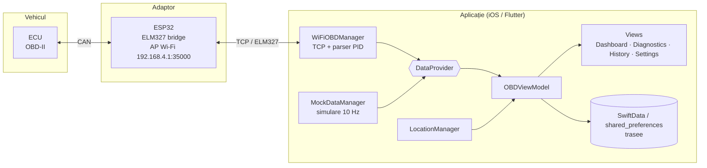

# PowerCAN Liquid Vision

**Aplicație mobilă de diagnoză OBD-II** pentru un adaptor ESP32, cu interfață „Liquid Glass”. Afișează în timp real turația, viteza, temperatura motorului și consumul, înregistrează traseele pe hartă și citește codurile de eroare (DTC).

| | |
|---|---|
| **Platforme** | iOS 17+ (SwiftUI, aplicația de referință) · Android (port Flutter) |
| **Hardware** | adaptor ESP32 cu bridge ELM327 peste Wi-Fi (TCP) |
| **Protocol** | OBD-II mod 01 (date live), comenzi ELM327 AT |
| **Arhitectură** | MVVM + protocol `DataProvider` (simulare / live) |
| **Stare** | prototip funcțional; mod simulare complet, mod live testat pe bridge Wi-Fi |

> **EN.** A mobile OBD-II dashboard for an ESP32-based ELM327 Wi-Fi bridge. It shows live engine metrics (RPM, speed, coolant temperature, fuel trims, MAF, estimated consumption), records GPS trips with speed-coloured routes and decodes diagnostic trouble codes. SwiftUI app for iOS 17 plus a Flutter port for Android. A built-in simulation engine makes it usable without a car.

---

## Funcționalități

| Ecran | Ce face |
|---|---|
| **Dashboard** | gauge-uri RPM și viteză, hartă termică a mașinii (încărcare motor), carduri pentru temperatură, fuel trim și consum, pornire/oprire traseu |
| **Diagnostics** | scanare și ștergere DTC, grupare pe categorii (P/C/B/U) și severitate |
| **History** | lista traseelor cu previzualizare pe hartă; detaliu cu ruta colorată după viteză, distanță, viteză maximă și medie |
| **Settings** | comutare *Simulated Data* / *Live OBD (Wi-Fi)*, configurarea endpoint-ului bridge-ului (host și port), informații despre protocol |

## Arhitectură



Detalii: [`docs/architecture.md`](docs/architecture.md) · protocolul și formulele: [`docs/obd-protocol.md`](docs/obd-protocol.md) · design: [`docs/design-system.md`](docs/design-system.md).

## Structura depozitului

```
PowerCAN-Liquid-Vision/
├── apps/
│   ├── ios/                 ← aplicația de referință: SwiftUI + SwiftData (XcodeGen)
│   └── flutter/             ← portul Android (Flutter + Provider)
├── docs/                    ← arhitectură, protocol OBD-II, design system, setup
├── dev-pack/                ← metoda de lucru cu asistenți AI: context, convenții, prompturi
├── AGENTS.md / CLAUDE.md    ← punctul de intrare pentru asistenți AI
├── CHANGELOG.md
└── LICENSE
```

## Pornire rapidă

**iOS** (Xcode 15+, macOS):

```bash
brew install xcodegen
cd apps/ios
xcodegen generate
open PowerCANLiquidVision.xcodeproj    # apoi Cmd+R pe un simulator iPhone
```

**Android** (Flutter stabil cu Dart 3.11+, Android SDK):

```bash
cd apps/flutter
flutter pub get
flutter run
```

Ambele aplicații pornesc în **modul simulare**, deci nu e nevoie de mașină sau adaptor. Pentru date reale: conectează telefonul la rețeaua Wi-Fi a ESP32, apoi alege *Settings → Live OBD (Wi-Fi)*. Endpoint-ul implicit este `192.168.4.1:35000`.

Ghiduri complete: [`docs/setup-ios.md`](docs/setup-ios.md) · [`docs/setup-flutter.md`](docs/setup-flutter.md).

## Lucrul cu asistenți AI (dev-pack)

Proiectul e pregătit pentru dezvoltare asistată de AI (Claude Code, Codex, Cursor, Copilot). [`AGENTS.md`](AGENTS.md) conține regulile de bază. [`dev-pack/`](dev-pack/) conține contextul proiectului, convențiile Swift și Dart, regula de **paritate iOS ↔ Flutter** și prompturi pentru sarcinile frecvente: un PID nou, o funcționalitate nouă pe ambele platforme, o componentă UI, un release. Fluxul recomandat este descris în [`dev-pack/README.md`](dev-pack/README.md).

## Roadmap

- [ ] Citirea DTC reală în modul live (OBD mod `03`) și ștergerea lor (mod `04`); acum scanarea funcționează doar în simulare
- [ ] Teste unitare pentru parserul PID (iOS și Flutter), pe răspunsuri ELM327 înregistrate
- [ ] Exportul traseelor (GPX / CSV)
- [ ] Transport BLE opțional, alături de Wi-Fi (implementarea inițială e în tag-ul `v1.0.0-ble`)
- [ ] Documentarea firmware-ului ESP32 (AP, port, framing)

## Licență

[MIT](LICENSE) © 2026 Iustin Iulian Dodiță. Nu este afiliat cu producătorii de vehicule sau de adaptoare menționați. Folosirea în trafic se face pe propria răspundere: nu manipula aplicația în timp ce conduci.
