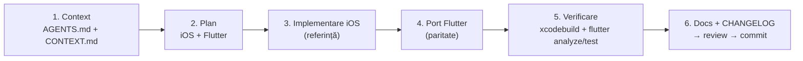

# dev-pack — dezvoltare asistată de AI

Dev-pack-ul dă unui asistent AI contextul corect al proiectului, ca să lucreze după aceleași reguli ca autorul. Fără el, asistentul ghicește structura, modifică doar una dintre cele două aplicații sau inventează formule OBD.

## Conținut

| Fișier | Rol |
|---|---|
| [`../AGENTS.md`](../AGENTS.md) | punctul de intrare, citit automat de majoritatea uneltelor |
| [`CONTEXT.md`](CONTEXT.md) | faptele proiectului: hardware, protocol, decizii, limitări cunoscute |
| [`CONVENTIONS.md`](CONVENTIONS.md) | stilul Swift și Dart, regula de paritate, versionarea și commit-urile |
| [`prompts/`](prompts/) | prompturi reutilizabile pentru sarcinile frecvente |
| [`checklists/`](checklists/) | verificări înainte de commit și înainte de release |

| Unealtă | Ce citește automat |
|---|---|
| Claude Code | `CLAUDE.md` (importă `AGENTS.md`) și comenzile din `.claude/commands/` |
| Codex, Cursor, Aider | `AGENTS.md` |
| GitHub Copilot | `.github/copilot-instructions.md` |

## Fluxul de lucru

1. **Context.** Pornește sesiunea din rădăcina repo-ului. Pentru sarcini netriviale, cere explicit citirea `dev-pack/CONTEXT.md`.
2. **Plan.** Asistentul enumeră fișierele pe care le va modifica pe **ambele** platforme, după tabelul din `docs/architecture.md`.
3. **iOS întâi.** iOS e implementarea de referință. Comportamentul se stabilește acolo.
4. **Portul Flutter.** Se traduce aceeași logică, cu aceleași nume de câmpuri, formule și praguri.
5. **Verificare.** Asistentul rulează comenzile din `AGENTS.md` și raportează rezultatul real.
6. **Documentație.** Actualizează `docs/` dacă s-a schimbat protocolul, arhitectura sau design-ul, plus `CHANGELOG.md` la secțiunea *Unreleased*. Apoi parcurgi [`checklists/pre-commit.md`](checklists/pre-commit.md).

## Prompturi

| Prompt | Când îl folosești |
|---|---|
| [`add-pid.md`](prompts/add-pid.md) | citești un parametru OBD nou (de ex. presiunea din rampă) |
| [`feature.md`](prompts/feature.md) | adaugi o funcționalitate pe ambele platforme |
| [`ui-component.md`](prompts/ui-component.md) | creezi sau modifici o componentă vizuală |
| [`release.md`](prompts/release.md) | pregătești o versiune nouă |
| [`code-review.md`](prompts/code-review.md) | ceri o revizuire critică |

## Bune practici

- **O sarcină pe sesiune.** Contextul lung degradează calitatea.
- **Asistentul nu are mașină.** Pe vehicul testezi tu. Asistentul lucrează în modul simulare și cu răspunsuri ELM327 înregistrate.
- **Cere dovezi.** Pentru „merge” cere ieșirea lui `xcodebuild` și `flutter test`, sau o captură din simulator.
- Când se schimbă o decizie, actualizează întâi `CONTEXT.md`.
