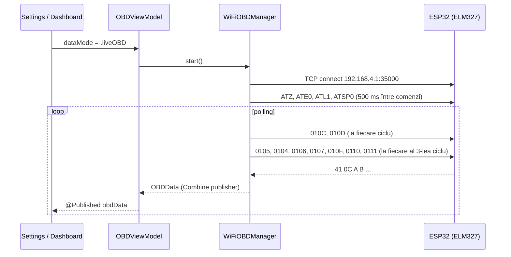

# Arhitectură

## Principii

1. **O singură sursă de date pentru UI.** View-urile citesc numai din `OBDViewModel`, niciodată direct din transport.
2. **Transport interschimbabil.** Simularea și conexiunea live implementează același protocol, `DataProvider`. Comutarea se face la runtime, din Settings.
3. **Offline-first.** Nu există backend. Traseele se salvează local, iar harta folosește MapKit pe iOS și OpenStreetMap pe Android.
4. **Paritate între platforme.** Aplicația iOS este referința. Portul Flutter oglindește aceleași modele, servicii și ecrane (vezi tabelul de mai jos).

## Straturi (iOS)

| Strat | Fișiere | Responsabilitate |
|---|---|---|
| Models | `Models/OBDData.swift`, `DTCModel.swift`, `TripRecord.swift`, `DataProvider.swift` | structuri de date, enum-uri de stare, protocolul de transport, modelul SwiftData `TripRecord` |
| Services | `Services/WiFiOBDManager.swift` | conexiune TCP (`Network.NWConnection`), handshake ELM327, polling PID, parsare, reconectare cu backoff exponențial |
| | `Services/MockDataManager.swift` | date simulate la 10 Hz: sinusoide corelate și zgomot |
| | `Services/MockDTCGenerator.swift` | coduri DTC aleatoare pentru modul simulare |
| | `Services/LocationManager.swift` | CoreLocation, puncte GPS pentru trasee |
| ViewModel | `ViewModels/OBDViewModel.swift` | `@MainActor`; publică `obdData` și `connectionState`, comută provider-ul, înregistrează traseul la 2 s, gestionează DTC și configurarea Wi-Fi (persistată în `UserDefaults`) |
| Design | `DesignSystem/Theme.swift`, `GlassModifiers.swift` | token-uri de culoare și tipografie, modificatori „liquid glass” |
| Views | `Views/{Dashboard,Diagnostics,History,Settings,Components}` | ecranele și componentele reutilizabile (`ArcGaugeView`, `CarHeatMapView`, `MetricCardView`, `ConnectionStatusBar`) |

## Fluxul datelor

## Stări de conexiune

`disconnected → connecting → initializing (handshake ELM327) → connected`. La pierderea conexiunii se încearcă reconectarea de până la 5 ori, cu întârziere de 2ⁿ s (maximum 30 s), apoi starea devine `error`. Modul simulare are starea dedicată `simulating`.

## Persistență

| Date | iOS | Flutter |
|---|---|---|
| Trasee (`TripRecord`, `RoutePoint`) | SwiftData | `shared_preferences` (JSON), `trip_storage.dart` |
| Endpoint Wi-Fi | `UserDefaults` (`wifi.obd.host`, `wifi.obd.port`) | `shared_preferences` |

## Corespondență iOS ↔ Flutter

| iOS | Flutter |
|---|---|
| `Models/OBDData.swift` | `lib/src/models/obd_data.dart` |
| `Models/DTCModel.swift` | `lib/src/models/dtc.dart` |
| `Models/TripRecord.swift` | `lib/src/models/trip_record.dart` |
| `Models/DataProvider.swift` | `lib/src/services/data_provider.dart` |
| `Services/WiFiOBDManager.swift` | `lib/src/services/wifi_obd_manager.dart` |
| `Services/MockDataManager.swift` | `lib/src/services/mock_data_manager.dart` |
| `Services/MockDTCGenerator.swift` | `lib/src/services/mock_dtc_generator.dart` |
| `Services/LocationManager.swift` | `lib/src/services/location_tracking_service.dart` |
| — (SwiftData) | `lib/src/services/trip_storage.dart` |
| `ViewModels/OBDViewModel.swift` | `lib/src/state/obd_controller.dart` (`ChangeNotifier` + Provider) |
| `DesignSystem/Theme.swift` | `lib/src/theme/lv_theme.dart` |
| `Views/ContentView.swift` | `lib/src/ui/app_shell.dart` |
| `Views/Dashboard/DashboardView.swift` | `lib/src/ui/screens/dashboard_screen.dart` |
| `Views/Diagnostics/DiagnosticsView.swift` | `lib/src/ui/screens/diagnostics_screen.dart` |
| `Views/History/HistoryView.swift`, `TripDetailView.swift` | `lib/src/ui/screens/history_screen.dart`, `trip_detail_screen.dart` |
| `Views/Settings/SettingsView.swift` | `lib/src/ui/screens/settings_screen.dart` |
| `Views/Components/*` | `lib/src/ui/widgets/*` |
